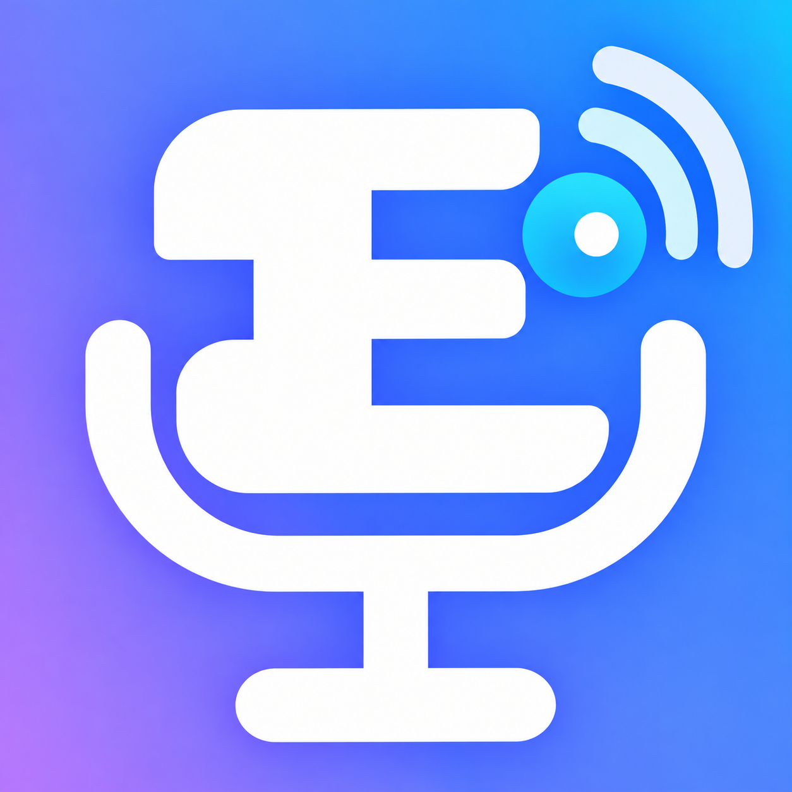

<div align="center">
  
  <h1>Euph-VBridge Relay</h1>
  <p>UDP-over-WebSocket relay для голосового чата Euphorium</p>
</div>

Relay принимает WebSocket-подключения, проверяет приветствие `PVW2` и передаёт голосовые UDP-пакеты к разрешённым Minecraft-адресам.

## Запуск

```bash
docker compose up -d --build
```

Публичный маршрут:

```text
wss://voice.femboyhouse.ru/voice
```

Контейнер слушает порт `8790` во внешней Docker-сети `matrix_default`. TLS и маршрут `/voice` обслуживает Caddy.

## Настройки

Параметры находятся в `docker-compose.yml`.

| Переменная | Назначение |
| --- | --- |
| `VOICE_ALLOWED_HOSTS` | Разрешённые домены и IP Minecraft-серверов |
| `VOICE_ALLOW_PORTS` | Разрешённые UDP-порты |
| `VOICE_MAX_CLIENTS` | Максимальное число одновременных клиентов |
| `VOICE_IDLE_TIMEOUT` | Таймаут неактивного соединения в секундах |
| `VOICE_MAX_FRAME` | Максимальный размер WebSocket-кадра |

Relay не публикует порт `8790` напрямую в интернет. Внешний доступ идёт через Caddy.

## Проверка

```bash
docker compose ps
docker compose logs --tail=100 voice-relay
```

## Лицензия

MIT. Подробности находятся в [`../LICENSE`](../LICENSE).
